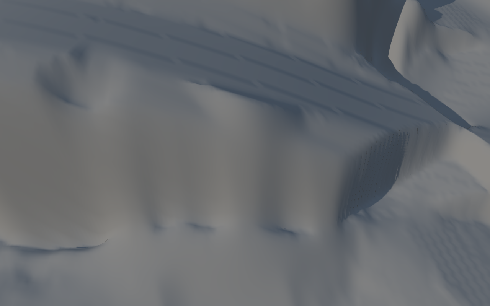
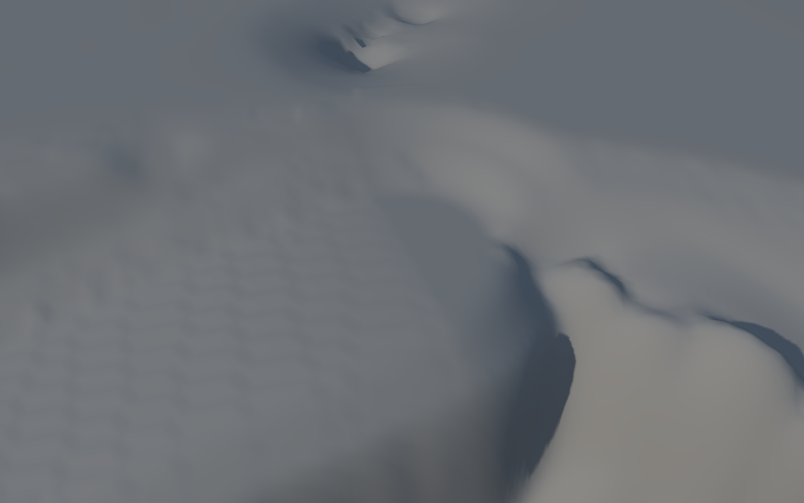

# Ergebnis: Wandkontur mit Distanzfeld

**Tag:** `kontur`
**Worktree/Branch:** `/workspace/wt_dorfmap_kontur`, `art/dorfmap-kontur`
**Vergleichsbasis:** Branchzustand vor dieser Änderung (`de0d9b5`), mit `c2`, Wellen und `WANDSTREIFEN=0`.

## Ergebnis

Das Ziel, die Aufsichtskontur der Wände zu glätten, ohne Regelregressionen oder Änderungen an D2, wurde mit den getesteten Distanzfeldparametern nicht erreicht. Die beste Gesamtvariante ist daher der unveränderte Bestand (`WANDKONTURV=0`, Standard). Dieser hält alle Zähler und Ausgabedaten exakt auf dem Ausgangswert. Die Varianten 1 und 2 bleiben für reproduzierbare Folgeversuche über `WANDKONTURV` schaltbar.

## Änderung

- `gen_relief.py`: neue Umgebungsvariable `WANDKONTURV` mit `0` (Bestand), `1` und `2`. Die Varianten bilden ein signiertes Distanzfeld der dilatierten Wandmaske und gewichten damit die Kontur in der Aufsicht. Das Wandraster und die Tesselierung werden nicht verändert.
- Variante 1: Übergangsbreite 0,75 m, Ziel-Rippenmultiplikator 2,0.
- Variante 2: Übergangsbreite 1,0 m, Ziel-Rippenmultiplikator 1,5; D2 wird bereits beim Quellschritt mit einem 5-m-Schutzsaum ausgenommen. Es gibt kein nachträgliches Zurückkopieren.
- `pruefung/export_gate.sh`: akzeptiert die angegebene `LOCHSCAN`-Datei und legt die Regel-, R8- und R9-Ausgaben bei einem Tag wie `kontur` unter `/tmp/*_kontur.json` ab. Prüfer und Schwellenwerte wurden nicht geändert.

## Regelzahlen: Bestand vor Änderung und finaler Standardlauf

Der finale Standardlauf (`WANDKONTURV=0`) hat dieselben Zähler wie die Vergleichsbasis. `Δ` ist Nachher minus Vorher. Die folgenden D1/G1/D2-Werte gelten ebenfalls jeweils vor und nachher; die Reliefdaten sind bytegleich.

| Prüfer | Regel | Vorher | Nachher | Δ | D1 | G1 | D2 |
|---|---|---:|---:|---:|---:|---:|---:|
| pruefe_regeln | R1_blind | 24 | 24 | 0 | 2 | 1 | 0 |
| pruefe_regeln | R2_getrennt | 15 | 15 | 0 | 1 | 0 | 1 |
| pruefe_regeln | R3_laengs_m | 35 | 35 | 0 | 6 | 1 | 0 |
| pruefe_regeln | R3_quer_pct | 23 | 23 | 0 | 11 | 0 | 0 |
| pruefe_regeln | R3_woelb_m | 22 | 22 | 0 | 10 | 0 | 0 |
| pruefe_regeln | R5_loch | 17 | 17 | 0 | 0 | 0 | 0 |
| pruefe_regeln | R6_wasser_schnee | 4 | 4 | 0 | 0 | 3 | 0 |
| pruefe_regeln | G2_spitze_oben | 3 | 3 | 0 | 0 | 0 | 0 |
| pruefe_regeln | G3_spitze_unten | 3 | 3 | 0 | 0 | 0 | 0 |
| pruefe_regeln | G2_spitze_oben_fein | 8 | 8 | 0 | 0 | 0 | 0 |
| pruefe_regeln | G3_spitze_unten_fein | 2 | 2 | 0 | 0 | 1 | 0 |
| pruefe_regeln | G5_beule_klippe | 68 | 68 | 0 | 1 | 0 | 0 |
| pruefe_regeln | G6_facette | 220 | 220 | 0 | 5 | 4 | 0 |
| pruefe_regeln | G7_wand_glatte_flaeche | 1 | 1 | 0 | 0 | 0 | 0 |
| pruefe_regeln | G8_fluss_nicht_bis_rand | 1 | 1 | 0 | 0 | 0 | 0 |
| pruefe_regeln | T1_fleckrand | 94 | 94 | 0 | 0 | 3 | 7 |
| pruefe_regeln | T2_textur_abgeschnitten_bildpruefung_offen | 1 | 1 | 0 | 0 | 0 | 0 |
| pruefe_regeln | T3_streifen_ringe_bildpruefung_offen | 1 | 1 | 0 | 0 | 0 | 0 |
| pruefe_regeln | T4_graue_flussstreifen_bildpruefung_offen | 1 | 1 | 0 | 0 | 0 | 0 |
| pruefe_regeln | T5_textur_vs_clay_bildpruefung_offen | 1 | 1 | 0 | 0 | 0 | 0 |
| pruefe_regeln | G7b_wandkontur_rauheit | 1 | 1 | 0 | 0 | 0 | 0 |
| pruefe_regeln | G7b_wandkontur_kantenschaerfe | 1 | 1 | 0 | 0 | 0 | 0 |
| pruefe_regeln | G7b_wandkontur_feld | 24 | 24 | 0 | 0 | 0 | 0 |
| **pruefe_regeln gesamt** |  | **570** | **570** | **0** | **36** | **13** | **8** |
| R8 | R8_stufe | 9 | 9 | 0 | 2 | 0 | 0 |
| R8 | R8_gitter | 10 | 10 | 0 | 2 | 0 | 0 |
| R8 | R8_quer | 5 | 5 | 0 | 1 | 0 | 0 |
| R8 | R8a_wegende | 24 | 24 | 0 | 3 | 1 | 0 |
| **R8 gesamt** |  | **48** | **48** | **0** | **8** | **1** | **0** |
| R9 | R8b_delle | 25 | 25 | 0 | 2 | 1 | 0 |
| R9 | R9_saegezahn | 34 | 34 | 0 | 1 | 1 | 0 |
| R9 | R9w_wellen | 275 | 275 | 0 | 23 | 6 | 0 |
| **R9 gesamt** |  | **334** | **334** | **0** | **26** | **8** | **0** |

Die Kachelspalten enthalten die Trefferzahlen je Regel für D1, G1 und D2; nicht aufgeführte Kacheln sind hier nicht Teil des verlangten Kachelvergleichs. D2 hat in R8 und R9 weiterhin null Treffer. In `pruefe_regeln` bleiben die acht vorhandenen Treffer (R2_getrennt: 1, T1_fleckrand: 7) unverändert; es kommt keiner hinzu.

## Variantenvergleich

| Variante | pruefe_regeln | R8 | R9 | Beobachtung | Entscheidung |
|---|---:|---:|---:|---|---|
| 0 (Standard) | 570 | 48 | 334 | G7b: Feld 24; Rauheit 0,505/0,687 (Quote 0,735), Kantenschärfe 1,298/1,992 (Quote 0,652). D2 und Gesamtrelief bytegleich. | Beste regelkonforme Variante; Standard. |
| 1 | 700 (+130) | 48 (0) | 423 (+89) | G11 +115, G5 +8, G6 +9, T1 +2; G7b-Feld 22. Rauheitsquote 0,750, Kantenschärfequote 0,668. D2 nicht bytegleich. | Verworfen: deutliche Regression und D2-Abweichung. |
| 2 | 685 (+115) | 48 (0) | 405 (+71) | G11 +107, G6 +7, T1 +5; G7b-Feld 23. Rauheitsquote 0,738, Kantenschärfequote 0,656. Der D2-Quellschutz ließ 5 Ein-ULP-Abweichungen in GB und 6 abweichende FW-Höhen übrig. | Verworfen: Regelregression, D2 nicht bytegleich. |

Beide Varianten verringern den G7b-Feldzähler nur um 1–2 und ändern die Rauheits- und Kantenschärfequoten kaum. Die Zuwächse überschreiten die erlaubte Regression von höchstens +5. Daher werden sie nicht zum Standard.

## Gate und Erzeugung

- `python3 gen_relief.py && python3 baue_html.py`: erfolgreich; nach jedem Build wurde `zellen_relief.csv` auf den Branchzustand zurückgesetzt.
- Raycast `loch_o18g.js`: `meshes=7`, `dreiecke=1700454`, `offen_innen=0`, `punkte=0`.
- `pruefe_regeln`: 570; R8: 48 (Stufe 9, Gitter 10, Quer 5, Wegende 24); R9: 334 (Delle 25, Sägezahn 34, Wellen 275).
- `pruefe_t42u.py`: Summe 0.
- LOD1-Sichtbarkeitsmessung über den mobilen LOD-Pfad: 1.174.554 gerenderte Dreiecke; damit unter 1,3 Mio. Die Shadow/FBO-Messung lag bei 829.101.
- `sh pruefung/export_gate.sh` mit `LOCHSCAN=/tmp/gate_loch_kontur.json` endete erwartungsgemäß mit Exit 1 und `GATE ROT: kein Export/ZIP`, weil der Pflichtprüfer die 570 vorhandenen Regelbefunde meldet. Der Lauf schreibt seine getaggten JSON-Dateien nach `/tmp/*_kontur.json`.

## Bilder

Die Nahbilder wurden mit `NODE_PATH=/tmp/w3/node_modules node pruefung/o18/render_t119u.js index.html OUTDIR cams.json '?clay=1&lod=0' 1280 800` erstellt und angesehen. D1 zeigt die Klippe/Wand unten links im Bereich um 140|35; die Wandkante bleibt sichtbar. G1 zeigt die Wandkante ohne sichtbare Änderung. SHA-256 der Vorher-/Nachher-Bilder ist je Kachel identisch, passend zum unveränderten Standardlauf.

| Kachel | Vorher | Nachher |
|---|---|---|
| D1 |  |  |
| G1 |  |  |

Die zusätzliche Datei `bilder_kontur/vorher/D2_kontrolle.png` ist ein leerer Kameraausschnitt und wurde nicht als Sichtprüfung gewertet; D2 ist nicht von der finalen Standardänderung betroffen.

## D2- und Reproduzierbarkeitsnachweis

- Gesamtes `relief_daten.json.gz` vor/nachher: SHA-256 `5e8fdb51c3f3dff9ad2c03c32c7a39ee1a4f97a3bc0942d47a352b1d0b4f0e88`.
- D2 G-Ausschnitt: `325f6fe2f41178f7e9c4b2198881438bc5ac70649ac4a0ee9836b463e6e1408c`.
- D2 GB-Ausschnitt: `749d3c4b637cf513c35d42c144e9a645ac96b5107f33f017d439d6286cb480f6`.
- D2 FW-Punktdaten samt Höhen: `6bcf7ea4440fc0db34582eb436d724a6e321eb41e23d8c8ef2ab404244084a14`.
- CSV-Zeilen für D2: `6965c81f72adb6c6e60f10affa26a0087525a5e21d29042a29beafccdc55b96f`; die Arbeitsdatei `zellen_relief.csv` ist nach dem Build auf den Branchstand zurückgesetzt.

## Annahmen, Grenzen und offene Punkte

- Die Variante 0 ist die Vergleichs- und Lieferkonfiguration. Der Distanzfeldansatz ist vorhanden, erfüllt mit den beiden geprüften Parametersätzen aber nicht die Regressionstoleranz und die Bytegleichheit für D2.
- Die Regelzahlen sind Befunde des bestehenden Pflichtprüfers, keine Aussage, dass die 570 Befunde neu entstanden sind. Im finalen Lauf ist keine Regelklasse gegenüber der Vergleichsbasis gestiegen.
- Es wurden keine Prüfer oder Schwellen geändert. Die Änderung am Gate betrifft ausschließlich tag-spezifische Eingabe-/Ausgabepfade.
- Offen bleibt ein weiterer Ansatz oder eine gezieltere Parameterisierung, die G7b verbessert und zugleich alle Regelklassen innerhalb +5 hält. Maximal zwei von drei erlaubten Varianten wurden geprüft.
