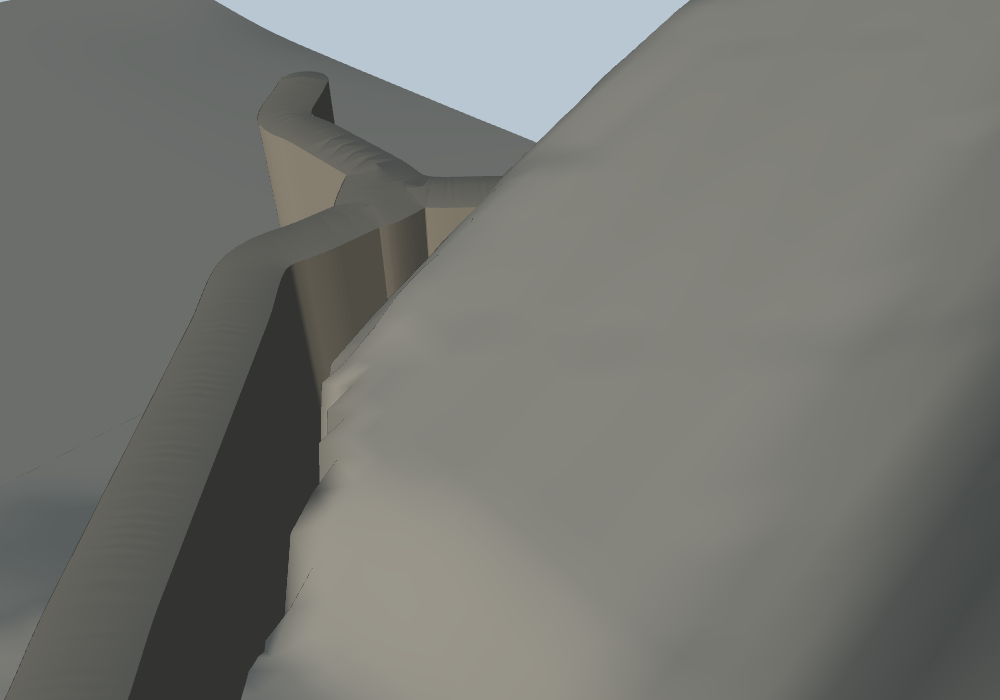

# Ergebnis p3d5

Stand 2026-11-07 · Worktree `/workspace/wt_dorfmap_p3d5` · Branch `art/dorfmap-p3d5` · Basis `origin/art/dorfmap-p3d4` (`d407307`)

## Ergebnis

Teilziele erreicht, Gesamtziel offen. Die Wandgeometrie ist als vereinigte Extrusion sichtbar zusammenhängend und D1/G1-R8a sowie G11 sind auf 0. Die D1-Kreuzungsstufe bleibt bei 0,116 m. R3 D1 bleibt 10 statt des VAR0-Ziels 6; D1-Sägezahn, G7b D1, G1-R9w und Clay-Wandmetriken verfehlen ihre Ziele. `neu/delta.py` meldet 17 Anstiege.

## Änderungen

- `neu/wand.py`: Wandgrundrisse werden pro Kachel vereinigt und als Kontur-Extrusion mit triangulierter Ober-/Unterseite gebaut. Die Kontur wird in Abschnitte von höchstens 0,5 m geteilt; der Wandfuß wird an den exakt gerenderten Terrain-Dreiecken abgetastet und 0,15 m eingebettet. Dadurch gibt es in D1 ein Wandfeature statt 7 einzelner Extrusionen; G1 hat 3 statt 13. Seiten-Normalen werden entlang der Kontur geglättet. D2 bleibt wandfrei. Fußvarianten sind über `RELIEF_WANDFUSS_VAR=0|1|2` schaltbar; Standard ist 1.
- `neu/objekte.py` und `neu/pipeline.py`: 81 Objektbasen (19 Bäume, 29 Geröll, 33 Steine) erhalten sparsame Höhenkorrekturen für D1/G1 im optionalen Meshmanifest. Quelllisten bleiben unverändert; kein Objekt wurde entfernt. Maximaler Höhenversatz: 2,897433 m.
- `pruefung/neu_mesh_adapter.py`: G11 erhält dieselben abgeleiteten Objektbasen wie das Mesh, ohne die Quelllisten im Reliefpaket umzuschreiben.
- `neu/viewer.js`: benutzerdefinierte Normalen aus dem Wandmanifest werden verwendet.
- `index.html`, `neu/index.html`, `neu/build.json`: deterministischer Neu-Build und Messwerte.
- `pruefung/bilder_p3d5/`: fünf VAR0-Kontrollbilder und fünf finale Meshbilder. `pruefung/delta_p3d5.md` enthält den vollständigen Delta-Lauf.

Keine Zellquellwerte/-spalten, Overlay-, Referenz- oder Regeldateien wurden geändert. D2 wurde nicht bearbeitet. Keine Schwelle oder Tests wurden geändert.

## Direkte Gates und sichtbares Neu-Mesh

Die Auftragsnotiz nennt `pruefe_regeln=596`; der unveränderte Direktlauf reproduziert 570. Die Direktwerte R8=48 und R9=334 stimmen mit der Notiz überein. Die zweite Zahlenspalte zeigt die unveränderten historischen Gates über dem sichtbaren Neu-Meshadapter; pro Kachel werden VAR0-Adapterkontrolle → Standardmesh angegeben.

| Regel | Direktquelle | p3d5 Mesh | D1 VAR0→Mesh | G1 VAR0→Mesh | D2 VAR0→Mesh |
|---|---:|---:|---:|---:|---:|
| G2_spitze_oben | 3 | 3 | 0→0 | 0→0 | 0→0 |
| G2_spitze_oben_fein | 8 | 8 | 0→0 | 0→0 | 0→0 |
| G3_spitze_unten | 3 | 3 | 0→0 | 0→0 | 0→0 |
| G3_spitze_unten_fein | 2 | 2 | 0→0 | 0→0 | 0→0 |
| G5_beule_klippe | 68 | 67 | 1→0 | 0→0 | 0→0 |
| G6_facette | 220 | 216 | 1→0 | 2→3 | 0→0 |
| G7_wand_glatte_flaeche | 1 | 1 | 0→0 | 0→0 | 0→0 |
| G7b_wandkontur_feld | 24 | 25 | 0→1 | 0→0 | 0→0 |
| G7b_wandkontur_kantenschaerfe | 1 | 1 | 0→0 | 0→0 | 0→0 |
| G7b_wandkontur_rauheit | 1 | 1 | 0→0 | 0→0 | 0→0 |
| G8_fluss_nicht_bis_rand | 1 | 1 | 0→0 | 0→0 | 0→0 |
| R1_blind | 24 | 24 | 2→2 | 1→1 | 0→0 |
| R2_getrennt | 15 | 15 | 1→1 | 0→0 | 1→1 |
| R3_laengs_m | 35 | 39 | 6→10 | 1→1 | 0→0 |
| R3_quer_pct | 23 | 19 | 11→7 | 0→0 | 0→0 |
| R3_woelb_m | 22 | 19 | 10→7 | 0→0 | 0→0 |
| R5_loch | 17 | 17 | 0→0 | 0→0 | 0→0 |
| R6_wasser_schnee | 4 | 4 | 0→0 | 3→3 | 0→0 |
| T1_fleckrand | 94 | 94 | 0→0 | 3→3 | 7→7 |
| T2_textur_abgeschnitten_bildpruefung_offen | 1 | 1 | 0→0 | 0→0 | 0→0 |
| T3_streifen_ringe_bildpruefung_offen | 1 | 1 | 0→0 | 0→0 | 0→0 |
| T4_graue_flussstreifen_bildpruefung_offen | 1 | 1 | 0→0 | 0→0 | 0→0 |
| T5_textur_vs_clay_bildpruefung_offen | 1 | 1 | 0→0 | 0→0 | 0→0 |

| R8-Regel | Direktquelle | p3d5 Mesh | D1 VAR0→Mesh | G1 VAR0→Mesh | D2 VAR0→Mesh |
|---|---:|---:|---:|---:|---:|
| R8_gitter | 10 | 8 | 1→0 | 0→0 | 0→0 |
| R8_quer | 5 | 4 | 1→0 | 0→0 | 0→0 |
| R8_stufe | 9 | 7 | 1→0 | 0→0 | 0→0 |
| R8a_wegende | 24 | 20 | 2→0 | 1→0 | 0→0 |

| R9-Regel | Direktquelle | p3d5 Mesh | D1 VAR0→Mesh | G1 VAR0→Mesh | D2 VAR0→Mesh |
|---|---:|---:|---:|---:|---:|
| R8b_delle | 25 | 22 | 1→0 | 0→0 | 0→0 |
| R9_saegezahn | 34 | 34 | 1→1 | 1→1 | 0→0 |
| R9w_wellen | 275 | 280 | 21→21 | 13→12 | 0→0 |

### Summen und Ziele

- `pruefe_regeln.py`: direkt 570; Neu-Meshadapter 563 (VAR0 569). D1-R3_laengs_m VAR0 6 → Mesh 10 (+4); G1 1→1, D2 0→0. Die Mehrtreffer sind ursächlich der radialen Kreuzungskomponente am Anschluss `rampe_2`/`rampe_11` zugeordnet, nicht dem Wegende-Auslauf: `RELIEF_WEGEND_VAR=0` ließ D1 bei 10, ein Test ohne Radialvariante ergab 11. Eine Korrektur ohne Stufenverschlechterung wurde nicht gefunden.
- R8 direkt 48 → Mesh 39; D1-R8 ist im p3d4-Vergleich 8→0 geblieben. Im aktuellen VAR0-Adapter sind D1-Stufe/Gitter/Quer/Wegende 1/1/1/2, Standardmesh 0/0/0/0. G1-R8a 1→0. Kreuzung `152.5|28.5`: Stufe 0,116 m, Gitter 0,000 m. D1-Ende `156.5|37.5`: Stufe 0,188 m, Gitter 0,089 m. Beide bleiben unter 0,20 m.
- R9 direkt 334 → Mesh 336 (+2; größte globale Zunahme aller Regeln ist R9w mit +5). D1-R9w VAR0 21 → Mesh 21; G1-R9w 13→12. Der Direktwert in G1 ist 6, also bleibt das Ziel ≤6 verfehlt. Getestete Wegendevariante 2 ergab G1 14 und global R9w 282; Standardvariante 1 bleibt besser. D1-Sägezahn bleibt ein Treffer mit 46 Zacken.
- G11 VAR0 4 (D1 2, G1 2) → Mesh 0 (D1/G1/D2 jeweils 0).
- G7b D1 VAR0 0 → Mesh 1; Ziel 0 verfehlt. D2 bleibt in R8/R9 trefferfrei; in `pruefe_regeln` kommt in D2 kein neuer Treffer gegenüber VAR0 dazu.
- R9w global direkt 275 → Mesh 280 (+5); G1 direkt 6 → Mesh 12 (+6). Der globale Grenzwert +5 wird eingehalten, das separate G1-Ziel nicht.

## Nahbildvergleich VAR0 → p3d5

Die fünf finalen Bilder wurden nach dem letzten Build mit denselben Kameras und 1000×700 gerendert und angesehen. Die vollständigen deterministischen Messwerte stehen in [delta_p3d5.md](delta_p3d5.md); `neu/delta.py` endet mit 17 Anstiegen. Davon liegen 15 außerhalb D2; die 2 positiven D2-Bildindikatoren werden wegen identischem Meshhash und bytegleicher Screenshotwiederholung als Rasterabweichung ausgewiesen.

| Ansicht/Metrik | VAR0 | p3d5 | Δ |
|---|---:|---:|---:|
| D1 Kreuzung · Facetten | 445 | 358 | −87 |
| D1 Kreuzung · Normalensprünge | 511 | 777 | +266 |
| D1 Kreuzung · Sprunginseln | 94 | 107 | +13 |
| D1 Wandfuß · Kanten-Zähne | 1562 | 1161 | −401 |
| D1 Wandfuß · Facetten | 382 | 556 | +174 |
| D1 Wandfuß · Normalensprünge | 3696 | 3287 | −409 |
| D1 Wandfuß · Sprunginseln | 173 | 320 | +147 |
| D1 Wegende · Facetten | 787 | 807 | +20 |
| D1 Wegende · Normalensprünge | 2453 | 2118 | −335 |
| G1 Wandfuß · Facetten | 532 | 535 | +3 |
| G1 Wandfuß · Normalensprünge | 2877 | 3294 | +417 |
| G1 Wandfuß · Sprunginseln | 172 | 162 | −10 |
| D2 Draufsicht · Normalensprünge | 2266 | 2275 | +9 |
| D2 Draufsicht · Sprunginseln | 6 | 9 | +3 |

Sichtbefund: D1 hat jetzt eine zusammenhängende Wandfläche ohne die vorherigen Blockstufen am sichtbaren Fuß; am T-Anschluss ist kein abgetrennter Splitter mehr erkennbar. Die Wandoberkante zeigt noch leichte Wellen. Zusätzlich wurden die Wandkanten positionsbasiert geprüft: D1 25.224 Kanten und G1 31.872 Kanten haben jeweils genau zwei angrenzende Dreiecke (keine offenen oder überzähligen geometrischen Kanten). Die Clay-Metriken widersprechen teilweise dem Sichtbefund: D1-Wandfuß-Facetten und -Sprunginseln sowie G1-Normalensprünge steigen über VAR0; das Ziel „alle Wandfußmetriken ≤ VAR0“ ist nicht erreicht.

D1-Höhenhash ist unverändert gegenüber p3d4 (`bbc2de2f…`); der Meshwert an `140|35` ist 7,8840365 m, identisch zum sichtbaren GB-Quellwert. D2-Hash ist `749d3c4b637cf513c35d42c144e9a645ac96b5107f33f017d439d6286cb480f6`; der Lochscan liefert 0 Punkte. Ein zweiter finaler D2-Screenshot war mit `cmp` bytegleich. Die D2-Bildindikatoren − bzw. + werden daher offengelegt, nicht als Höhenänderung gewertet.

## Build, Integrität und Tests

- `RELIEF_NEU=1 python3 gen_relief.py` und `RELIEF_NEU=1 python3 baue_html.py`: erfolgreich.
- LOD1: **126.792** Dreiecke von 1.300.000; Wände 38.064 Dreiecke; Terrain 88.728 Dreiecke.
- Wandmanifest: D1 1 Feature/16.816 Dreiecke; G1 3 Features/21.248 Dreiecke; D2 0.
- Lochscan direkt und unter `xvfb-run` mit `RAND=0`: 9 Meshes, 88.728 Dreiecke, **0 offene Innenkanten, 0 Punkte**.
- D2: 0 geänderte Terrainvertices; Meshhash unverändert. `zellen_quell_diff=0`; `pruefe_t42u.py`: **Summe 0**.
- `PYTHONPATH=/tmp/p3d5_pydeps python3 -m pytest -q neu/tests`: **26 bestanden, 5 fehlgeschlagen**. Offen: globales R8a (20 Treffer außerhalb D1/G1), D1-Sägezahn (46), feste Wand-Negativreferenz 2,24<3,00, F1/C1-Wegende (0,17 m bzw. keine C1-Messung) und Schatten-Hochfrequenz 0,307>0,25. Test- und Schwellenwerte blieben unverändert. Der deterministische read-only-Pakettest besteht wieder.
- `git diff --check`: sauber. `pytest` wurde für den Lauf in `/tmp/p3d5_pydeps` bereitgestellt; es änderte keine Repo-Abhängigkeiten.

## Annahmen, Grenzen und offene Punkte

- Der 596-Treffer-Ausgangswert für `pruefe_regeln` ließ sich auf der unveränderten Eingabe nicht reproduzieren; gemessen wurden 570. R8/R9 reproduzierten exakt 48/334.
- Die Terrainänderungen stammen aus p3d4 und wurden für p3d5 nicht verändert. Wandvertices werden für getrennte Seiten-Normalen an den gleichen Koordinaten dupliziert; die dokumentierte Wandkantenprüfung zählt deshalb geometrische Kanten nach Koordinaten, nicht nach rohen Index-IDs.
- R3 D1 (+4 gegen VAR0), R9w G1 (12 statt ≤6), G7b D1 (1 statt 0), D1-Sägezahn und mehrere Clay-Metriken bleiben offen. `delta.py` meldet trotz D2-Ausnahme 15 weitere positive Deltas.
- Laufzeitmodell und Reasoning-Aufwand waren in dieser Umgebung nicht auslesbar. Da die Codex-Konfiguration nicht geändert werden durfte, kann ich `gpt-6-luna`/`xhigh` nicht belegen; ein entsprechender Laufzeitlog liegt nicht vor.
- Keine Nachrichten wurden versandt; keine Secrets gelesen; keine kostenpflichtigen Dienste verwendet.

**Gesamtziel nicht vollständig erreicht.** D2, t42u, R8a D1/G1 und G11 sind im Ziel; R3, R9w G1 und Clay-Wandmetriken verfehlen es weiterhin.
